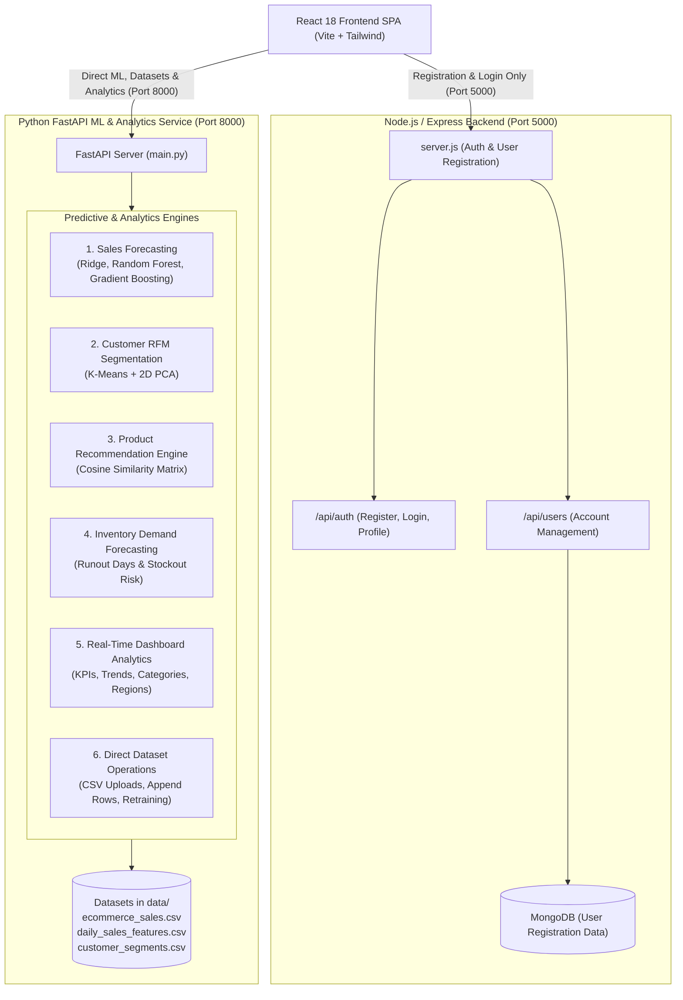
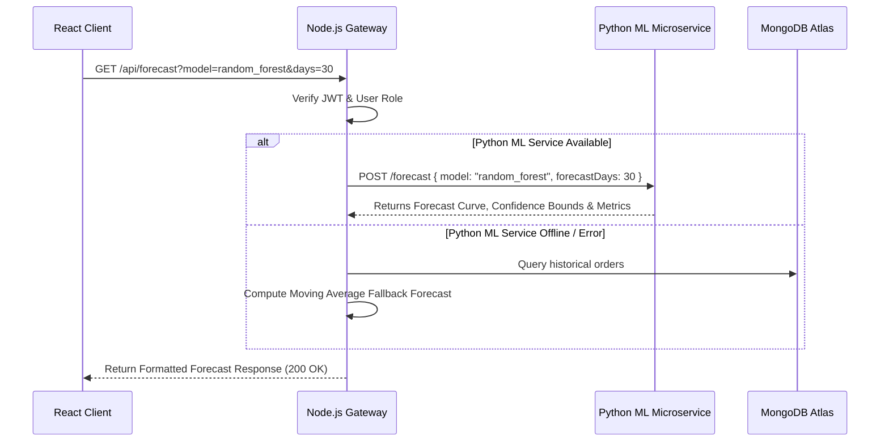
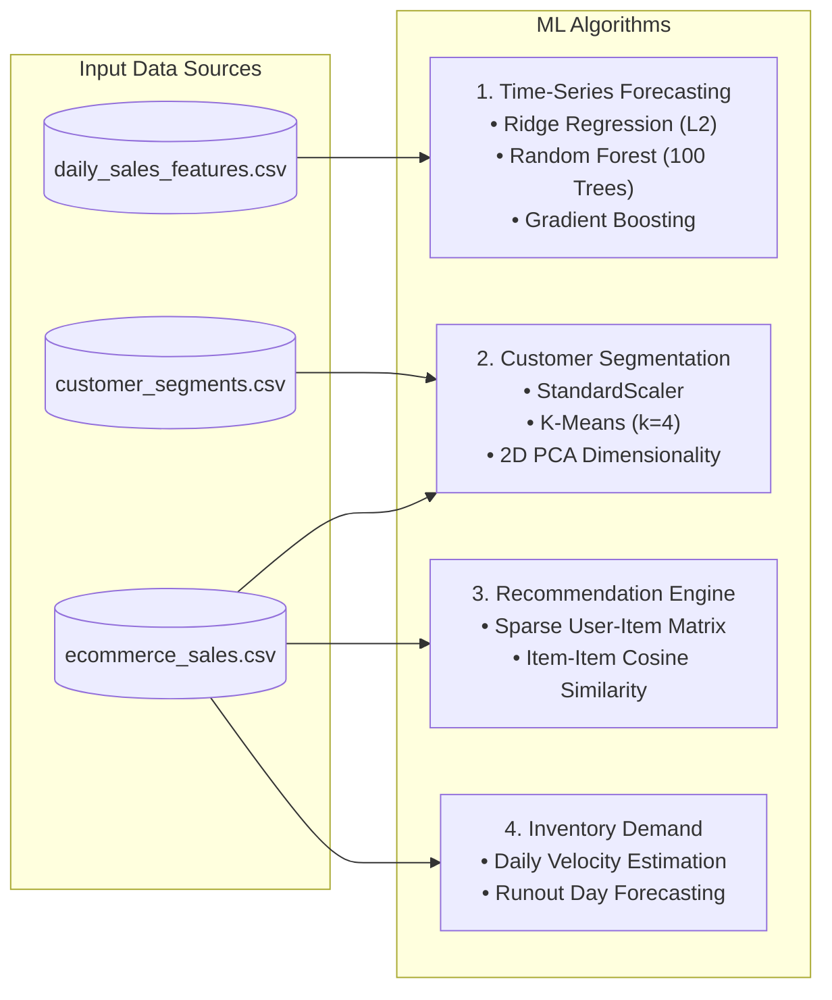

# SalesIQ: Complete Backend & System Architecture Guide

---

## 1. Executive Summary

**SalesIQ** uses a decoupled architecture tailored for high performance and clean separation of concerns:

1. **Presentation Layer**: A single-page application (SPA) built with React 18, Vite, Lucide Icons, and Tailwind CSS.
2. **Registration & Auth Backend**: A streamlined Node.js and Express.js backend exclusively dedicated to user registration, authentication (JWT, bcrypt), and user account management.
3. **Machine Learning & Analytics Tier**: A high-performance Python 3.10+ FastAPI service connected directly to the frontend for ML predictions (Sales Forecasting, Customer RFM Segmentation, Product Recommendations, Inventory Demand), live Dashboard Analytics, and direct dataset CSV additions & uploads.
4. **Data Persistence Tier**: CSV datasets stored directly in the `data/` repository for machine learning models and training pipelines, plus MongoDB for user registration records.

---

## 2. End-to-End System Architecture




---

## 3. Project Directory Structure

```text
SalesIQ/
├── 📁 client/                       # Frontend Presentation Tier (React 18 + Vite)
│   ├── 📁 src/
│   │   ├── 📁 components/           # UI Components (Navbar, Sidebar, StatCard, Charts, ProtectedRoute)
│   │   ├── 📁 context/              # Global State (AuthContext with localStorage sync)
│   │   ├── 📁 pages/                # 11 Application Views
│   │   │   ├── Dashboard.jsx        # Revenue KPIs & Sales Trends
│   │   │   ├── Forecasting.jsx      # Multi-Model Sales Forecasting (Ridge/RF/GBM)
│   │   │   ├── CustomerSegmentation.jsx # RFM Cluster Grid & 2D PCA Visualizer
│   │   │   ├── Recommendations.jsx  # Collaborative Filtering Cross-Sell Engine
│   │   │   ├── Inventory.jsx        # Stock Velocity & Reorder Recommendations
│   │   │   ├── Alerts.jsx           # Stockout Warnings & Revenue Anomaly Alerts
│   │   │   ├── DataManagement.jsx   # CSV Ingestion, ETL & Retraining Hub
│   │   │   ├── AdminPanel.jsx       # User Role Management & System Status
│   │   │   ├── Login.jsx            # Authentication & Quick Demo One-Click Access
│   │   │   ├── UserProfile.jsx      # Manager/Admin Account Settings
│   │   │   └── NotFound.jsx         # 404 Fallback View
│   │   ├── 📁 services/             # Axios API Client with JWT Interceptors (api.js)
│   │   ├── App.jsx                  # Route Declarations & RBAC Routing
│   │   └── index.css                # Custom Glassmorphism Design System Tokens
│   ├── package.json
│   └── vite.config.js
│
├── 📁 server/                       # Node.js Express REST API Gateway
│   ├── 📁 config/                   # Database Connectivity (db.js - Atlas + In-Memory Fallback)
│   ├── 📁 controllers/              # 9 Request Controllers (Business Logic)
│   ├── 📁 middleware/               # Auth Token Verification & Role-Based Access Control
│   ├── 📁 models/                   # 9 Mongoose Schemas (User, Order, Customer, Product, Inventory, Alert, etc.)
│   ├── 📁 routes/                   # Modular Express Route Definitions
│   ├── 📁 scripts/                  # Data Seeding Scripts (seedData.js)
│   ├── 📁 services/                 # Microservice Bridge (mlService.js)
│   ├── .env                         # Environment Variables (MONGO_URI, JWT_SECRET, ML_SERVICE_URL)
│   ├── package.json
│   └── server.js                    # Express Application Entry Point
│
├── 📁 ml-service/                   # Python 3.10+ FastAPI Machine Learning Service
│   ├── 📁 services/
│   │   ├── forecasting.py           # Ridge, Random Forest & Gradient Boosting Regressors
│   │   ├── segmentation.py          # RFM Normalization, K-Means Clustering & 2D PCA Mapping
│   │   ├── recommendation.py        # Item-Item Cosine Similarity & Bundle Generation
│   │   └── inventory_demand.py      # Demand Velocity & Stock Coverage Estimation
│   ├── main.py                      # FastAPI Routes, CORS, and Pydantic Data Models
│   └── requirements.txt             # Python Package Dependencies
│
├── 📁 data/                         # CSV Datasets for Training & ETL Ingestion
│   ├── ecommerce_sales.csv          # Raw transaction records
│   ├── daily_sales_features.csv     # Engineered time-series lag features
│   ├── customer_segments.csv        # Precomputed RFM customer records
│   └── online_retail.csv            # Retail transaction benchmarks
│
├── 📁 models/                       # Serialized Model Artifacts (.pkl)
│   ├── ridge_sales_model.pkl
│   ├── ridge_scaler.pkl
│   ├── random_forest_sales_model.pkl
│   └── gradient_boosting_sales_model.pkl
│
├── 📁 docs/                         # Technical Architecture & Algorithm Guides
│   ├── BACKEND_ARCHITECTURE.md      # This Document
│   └── FORECASTING_MODELS_GUIDE.md  # Deep Dive on Time-Series Metrics & Math
│
├── render.yaml                      # Blueprint for Multi-Service Cloud Deployment
└── README.md                        # Project Overview & Getting Started Guide
```

---

## 4. Backend Gateway Tier (Node.js / Express)

### 4.1 Entrypoint & Global Middlewares ([`server/server.js`](file:///c:/Users/Sayali%20Jadhav/Desktop/Web_Development/data_analytics_techready/SalesIQ/server/server.js))
* **CORS**: Configured to permit cross-origin requests from the React frontend and external clients.
* **Body Parser**: Handles up to `50MB` JSON and URL-encoded payloads to support bulk CSV imports.
* **Root Health & Status Route (`GET /`)**: Returns a live diagnostic report indicating backend uptime, active MongoDB database name, connection status, and API routes.
* **Health Check Route (`GET /api/health`)**: Lightweight diagnostic endpoint for deployment platform health monitors.

### 4.2 Authentication & Security Layer
* **Password Encryption**: [`authController.js`](file:///c:/Users/Sayali%20Jadhav/Desktop/Web_Development/data_analytics_techready/SalesIQ/server/controllers/authController.js) utilizes `bcryptjs` with 10 salt rounds to hash credentials before persisting to MongoDB.
* **Token Authentication**: Issues signed **JSON Web Tokens (JWT)** with a 7-day expiration containing the user's ID, role, name, and email.
* **Role-Based Access Control (RBAC)**:
  * **`Admin`**: Unrestricted access to all endpoints, including user management, database purging, dataset uploads, and ML model retraining.
  * **`Manager`**: Operational access to dashboards, forecasting, customer clustering, recommendations, and alert management.

### 4.3 Microservice Communication Bridge ([`services/mlService.js`](file:///c:/Users/Sayali%20Jadhav/Desktop/Web_Development/data_analytics_techready/SalesIQ/server/services/mlService.js))
The Node.js gateway communicates with the Python ML microservice via HTTP requests (`ML_SERVICE_URL`).



---

## 5. Machine Learning Microservice Tier (Python FastAPI)

The ML service is encapsulated within `ml-service/` and runs on **Port 8000** using Uvicorn.

### 5.1 The Four Machine Learning Engines



#### 1. Time-Series Sales Forecasting ([`forecasting.py`](file:///c:/Users/Sayali%20Jadhav/Desktop/Web_Development/data_analytics_techready/SalesIQ/ml-service/services/forecasting.py))
* **Models**:
  * **Ridge Regression**: Linear baseline with $L_2$ regularization preventing collinearity between time-lag variables.
  * **Random Forest Regressor**: Non-linear ensemble model capturing calendar interactions across 100 parallel trees.
  * **Gradient Boosting Regressor**: Sequential boosting model iteratively minimizing residual errors.
* **Engineered Features (11 dimensions)**:
  * Calendar: `day_of_week`, `day`, `month`, `is_weekend`
  * Time Lags: `lag_1`, `lag_7`, `lag_14`, `lag_28`
  * Trailing Statistics: `rolling_mean_7`, `rolling_mean_14`, `rolling_std_7`
* **Forecasting Methodology**: **Recursive Multi-Step Forecasting** appending dynamic predictions into the lag buffer with **95% Confidence Bounds** ($\pm 1.96 \times \text{MAE}$).

#### 2. Customer RFM Segmentation & PCA ([`segmentation.py`](file:///c:/Users/Sayali%20Jadhav/Desktop/Web_Development/data_analytics_techready/SalesIQ/ml-service/services/segmentation.py))
* **Algorithm**: Standardizes Recency, Frequency, and Monetary metrics via `StandardScaler`, clusters customer behaviors via **K-Means** ($k=4$), and projects the 3D feature space onto 2 principal components via **PCA** (`PCA1`, `PCA2`).
* **Persona Mapping**:
  * **Champions**: High spending, highest frequency, lowest recency.
  * **Loyal Customers**: Consistent purchasing patterns and strong retention.
  * **Potential Loyalists**: High initial spend with moderate recency.
  * **At Risk**: High historical spend but dormant for an extended period.
  * **Lost Customers**: Low lifetime value and long inactivity.

#### 3. Collaborative Product Recommendation ([`recommendation.py`](file:///c:/Users/Sayali%20Jadhav/Desktop/Web_Development/data_analytics_techready/SalesIQ/ml-service/services/recommendation.py))
* **Algorithm**: Constructs a sparse Customer $\times$ Product purchase quantity matrix and computes the **Item-Item Cosine Similarity Matrix**:
  $$\text{Cosine Similarity}(u, v) = \frac{u \cdot v}{\|u\|_2 \|v\|_2}$$
* **Output**: Top-$N$ complementary cross-sell recommendations with percentage match scores.

#### 4. Inventory Demand & Stockout Risk Forecasting ([`inventory_demand.py`](file:///c:/Users/Sayali%20Jadhav/Desktop/Web_Development/data_analytics_techready/SalesIQ/ml-service/services/inventory_demand.py))
* **Algorithm**: Evaluates historical product sales velocity to project daily depletion rates and calculate **Estimated Coverage Days** ($\frac{\text{Current Stock}}{\text{Predicted Daily Demand}}$).
* **Stock Health Classifications**:
  * **Out of Stock**: `Current Stock == 0`
  * **Critical**: `Current Stock < 10`
  * **Low Stock**: `Current Stock < Reorder Level`
  * **Healthy**: `Current Stock >= Reorder Level`

---

## 6. Database & Persistence Tier (MongoDB)

### 6.1 Mongoose Schemas Overview

| Schema File | Collection | Description & Key Fields |
| :--- | :--- | :--- |
| [`User.js`](file:///c:/Users/Sayali%20Jadhav/Desktop/Web_Development/data_analytics_techready/SalesIQ/server/models/User.js) | `users` | `name`, `email`, `password`, `role` (`Admin`/`Manager`), `active` |
| [`Order.js`](file:///c:/Users/Sayali%20Jadhav/Desktop/Web_Development/data_analytics_techready/SalesIQ/server/models/Order.js) | `orders` | `orderId`, `customerId`, `orderDate`, `totalAmount`, `status`, `paymentMethod` |
| [`OrderItem.js`](file:///c:/Users/Sayali%20Jadhav/Desktop/Web_Development/data_analytics_techready/SalesIQ/server/models/OrderItem.js) | `orderitems` | `orderId`, `productId`, `quantity`, `price`, `total` |
| [`Customer.js`](file:///c:/Users/Sayali%20Jadhav/Desktop/Web_Development/data_analytics_techready/SalesIQ/server/models/Customer.js) | `customers` | `customerId`, `name`, `recency`, `frequency`, `monetary`, `segment`, `cluster` |
| [`Product.js`](file:///c:/Users/Sayali%20Jadhav/Desktop/Web_Development/data_analytics_techready/SalesIQ/server/models/Product.js) | `products` | `productId`, `name`, `category`, `price`, `cost`, `stock` |
| [`Inventory.js`](file:///c:/Users/Sayali%20Jadhav/Desktop/Web_Development/data_analytics_techready/SalesIQ/server/models/Inventory.js) | `inventories` | `productId`, `currentStock`, `reorderLevel`, `predictedDailyDemand`, `status` |
| [`Alert.js`](file:///c:/Users/Sayali%20Jadhav/Desktop/Web_Development/data_analytics_techready/SalesIQ/server/models/Alert.js) | `alerts` | `type` (`Inventory`/`Sales`), `severity` (`critical`/`warning`), `message`, `resolved` |
| [`Dataset.js`](file:///c:/Users/Sayali%20Jadhav/Desktop/Web_Development/data_analytics_techready/SalesIQ/server/models/Dataset.js) | `datasets` | `filename`, `rowCount`, `fileSize`, `uploadedBy`, `uploadDate` |
| [`Prediction.js`](file:///c:/Users/Sayali%20Jadhav/Desktop/Web_Development/data_analytics_techready/SalesIQ/server/models/Prediction.js) | `predictions` | `modelType`, `forecastHorizon`, `predictedRevenue`, `metrics` |

### 6.2 Cloud Database & In-Memory Auto-Failover ([`server/config/db.js`](file:///c:/Users/Sayali%20Jadhav/Desktop/Web_Development/data_analytics_techready/SalesIQ/server/config/db.js))
1. Attempts connection to **MongoDB Atlas Cloud** using `MONGO_URI`.
2. If network access is unavailable, it spins up an embedded **MongoMemoryServer** instance locally.
3. Automatically executes database seeding from [`data/ecommerce_sales.csv`](file:///c:/Users/Sayali%20Jadhav/Desktop/Web_Development/data_analytics_techready/SalesIQ/data/ecommerce_sales.csv) if the database is unpopulated.

---

## 7. REST API Endpoints Specification

### Authentication Routes (`/api/auth`)
* `POST /api/auth/register` — Create a new Manager or Admin account.
* `POST /api/auth/login` — Authenticate with email/password and obtain JWT.
* `GET /api/auth/profile` — Fetch the current authenticated user profile.

### Dashboard & Analytics Routes (`/api/dashboard`)
* `GET /api/dashboard/stats` — Retrieve high-level KPI cards (Revenue, Orders, Customers, Growth).
* `GET /api/dashboard/sales-trend` — Get time-aggregated sales revenue curves.
* `GET /api/dashboard/top-products` — List highest performing products and categories.

### Machine Learning Routes
* `GET /api/forecast` — Run 7-day to 60-day recursive sales predictions.
* `GET /api/customers/segmentation` — Retrieve RFM clusters and 2D PCA scatter points.
* `GET /api/recommendations/:productId` — Get top cross-sell product bundles.
* `GET /api/inventory/demand` — Fetch stock velocity and stockout predictions.
* `POST /api/data/retrain` — Trigger model retraining across all datasets.

### Administration & Data Management Routes
* `GET /api/users` — List and audit all system users (`Admin` only).
* `PATCH /api/users/:id/toggle-status` — Activate/Deactivate user access (`Admin` only).
* `POST /api/data/upload` — Ingest bulk CSV sales files through Multer stream.
* `DELETE /api/data/reset` — Clear database collections and re-seed from clean CSVs.

---

## 8. Cloud Deployment Blueprint ([`render.yaml`](file:///c:/Users/Sayali%20Jadhav/Desktop/Web_Development/data_analytics_techready/SalesIQ/render.yaml))

SalesIQ is fully configured for continuous deployment on cloud platforms (e.g., Render, Railway, Vercel) using declarative Infrastructure-as-Code:

| Service Name | Type | Runtime | Build Command | Start Command |
| :--- | :--- | :--- | :--- | :--- |
| **`salesiq-ml-service`** | Web Service | Python 3.10+ | `pip install -r requirements.txt` | `uvicorn main:app --host 0.0.0.0 --port $PORT` |
| **`salesiq-backend`** | Web Service | Node.js | `npm install` | `node server.js` |
| **`salesiq-frontend`** | Static Site | React / Vite | `npm install && npm run build` | *Static publish (`dist/`)* |

### Production Environment Variables
* `MONGO_URI`: MongoDB Atlas connection string (`mongodb+srv://...`).
* `JWT_SECRET`: 256-bit cryptographically secure token signing key.
* `NODE_ENV`: `production`.
* `ML_SERVICE_URL`: URL of the deployed Python ML service.
* `VITE_API_URL`: URL of the deployed Express backend gateway.
